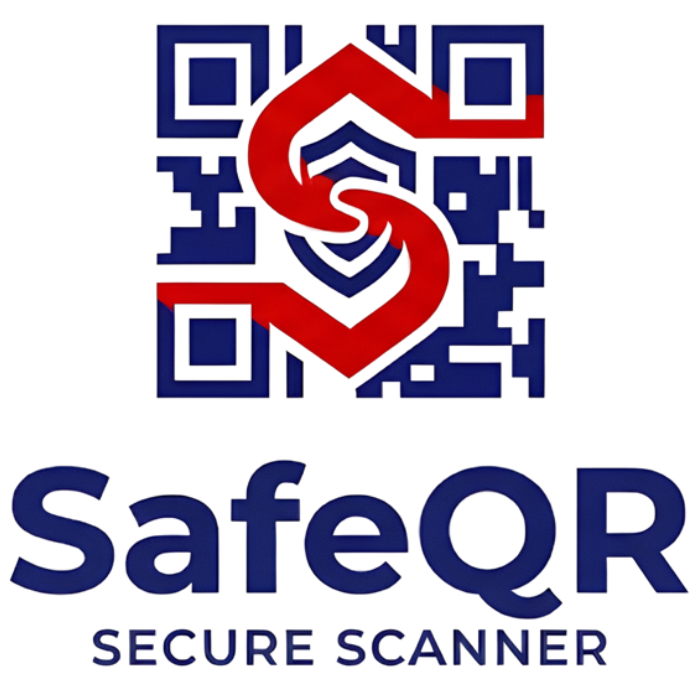

<h1 align="center"> SafeQR — Secure QR Verification & Payment Shield 🛡️ </h1>

<p align="center">
  
</p>

<p align="center">
> **SafeQR** is a third-party QR verification and payment confirmation prototype built for a university case study on **Malaysia's cashless society**. It is designed to mitigate fraud without requiring direct banking API modifications.
</p>

<p align="center">
  <a href="https://react.dev/">
    
  </a>
  <a href="https://vitejs.dev/">
    
  </a>
  <a href="https://tailwindcss.com/">
    
  </a>
  
</p>

---

## 🎯 Problems Solved

1. **Physical QR Sticker Tampering Scams**
   - *Problem:* Fraudsters paste fraudulent QR stickers over legitimate vendor payment stands at hawker stalls and night markets.
   - *SafeQR Solution:* Optical verification cross-references premise location and SSM registration against national DuitNow databases, warning users of mule account mismatches before funds can be transferred.

2. **Fake Payment Screenshots & Receipts**
   - *Problem:* Scammers present falsified payment screenshots or altered bank apps to busy merchants without transferring money.
   - *SafeQR Solution:*
     - **Loud Voice Confirmation (`window.speechSynthesis`):** Automatically broadcasts *"Payment successful. Fifteen Ringgit received by Kedai Makan Ali."* to both parties upon settlement.
     - **Real-Time Merchant Terminal Feed:** Independent live settlement feed and audible double-chime alerts (`Web Audio API`).

3. **Digital Divide & Elderly Accessibility**
   - *Problem:* Senior citizens struggle with complicated banking navigations and small typography.
   - *SafeQR Solution:* **Elderly Mode** provides high-contrast typography (24px–36px), a simplified 3-button layout, a prominent **SCAN & PAY** target, and a direct 1-tap connection to Malaysia's **National Scam Response Centre (NSRC 997)**.

---

## ⚠️ Important Note: Can You Just Double-Click `index.html`?

> **No, you cannot simply double-click `index.html` in File Explorer.**

Modern web applications built with **React and Vite** rely on:
- **JavaScript ES Modules** (`<script type="module">`)
- **Browser APIs** (`window.speechSynthesis`, `Web Audio API`)
- **Asset resolution** (`/img/logo.png`)

When opened via `file:///C:/.../index.html`, browsers block these features for security reasons (CORS / Cross-Origin restrictions). **A local web server is required.**

Follow the quick steps below to run the project.

---

## 🚀 How to Run the Project Locally

### 1. Prerequisites
Ensure you have **Node.js** (v18 or newer) installed on your computer.
- Download from: [https://nodejs.org/](https://nodejs.org/)
- Check installation in your terminal:
  ```bash
  node -v
  npm -v
  ```

---

### 2. Clone and Install

```bash
# 1. Clone this repository
git clone https://github.com/KuDanial/SafeQR-ICT653.git

# 2. Navigate into the project folder
cd SafeQR-ICT653

# 3. Install dependencies
npm install
```

---

### 3. Start the Local Server

```bash
npm run dev
```

Your terminal will display:
```
  VITE v6.4.6  ready in 480 ms

  ➜  Local:   http://localhost:5173/
  ➜  Network: use --host to expose
```

Open your browser (Chrome or Edge recommended) and navigate to:
👉 **`http://localhost:5173/`**

---

### 4. Alternative: Build & Preview Production

To test the optimized production build:
```bash
# Create production build
npm run build

# Preview production build locally
npm run preview
```

---

## 🎬 Video Demonstration Walkthrough (For Examiners)

Use the top ribbon in the prototype to toggle between personas:

| Step | Role / Mode | What to Show & Demonstrate |
| :--- | :--- | :--- |
| **1** | **🔑 Auth** | Sign in screen featuring the official **SafeQR Secure Scanner** logo and role selector. |
| **2** | **👤 Customer** | • Tap **"Simulate Scan QR Code"** (or the elevated center **SCAN** button on the bottom navigation bar).<br>• View the laser sweep animation and the verified merchant card for *Kedai Makan Ali*.<br>• Tap **"Pay RM 15.00"** — listen to the **Web Speech API** speak the confirmation out loud and observe the green checkmark.<br>• Tap **Replay Voice** to demonstrate the audio again. |
| **3** | **🚨 Scam Demo** | • On the Customer dashboard, switch the Scenario tab to **"🚨 Sticker Scam"**.<br>• Tap the center **SCAN** button.<br>• Observe the red warning: *QR Sticker Tamper Detected* alerting to mule account *SYNDICATE TRADING ENT*.<br>• Click **"Report This Fake QR Sticker to PDRM / Admin"** — hear the dispatch audio and view the case reference `#NSRC-997-XXXX`. |
| **4** | **👴 Elderly Mode** | • Click **"Elderly Mode"** in the top-right.<br>• Show the high-contrast layout, enlarged fonts, and the simplified 3-button floating navigation bar.<br>• Tap **"HELP 997"** to demonstrate the direct NSRC hotline dialog. |
| **5** | **🏪 Merchant** | • Switch to **Merchant Mode**.<br>• Click **"Simulate Incoming Payment (RM 15.00)"**.<br>• Listen to the audible double-tone chime and spoken announcement.<br>• Show the **Anti-Fake Screenshot Checker** where reference numbers can be validated against the authentic ledger. |
| **6** | **🛡️ Admin** | • Switch to **Admin Mode**.<br>• View the pending merchant approvals (*Approve / Reject*).<br>• View the scam report submitted in Step 3 in the live queue and click **"Mark Resolved & Blacklist Mule"**. |

---

## 🛠️ Tech Stack

- **Framework:** React 18, Vite 6
- **Styling:** Tailwind CSS, Plus Jakarta Sans typography
- **Icons:** Lucide React
- **Audio & Speech:**
  - `window.speechSynthesis` (Web Speech API) for spoken payment confirmations.
  - `window.AudioContext` (Web Audio API Synthesizer) for merchant payment chimes (zero external audio dependencies).
- **Design Specifications:** Native FigCraft design file included at [`Untitled.figcraft`](./Untitled.figcraft).

---

## 📁 Repository Structure

```
SafeQR/
├── public/
│   └── img/
│       ├── logo.png             # Official SafeQR Secure Scanner Logo
│       └── logo-white.png       # Monochrome logo variant
├── src/
│   ├── components/
│   │   ├── PhoneContainer.jsx   # Mobile frame shell & top demo control ribbon
│   │   ├── AuthScreen.jsx       # Login & persona switcher
│   │   ├── CustomerDashboard.jsx# Customer UI, scanner, floating nav, voice confirmation
│   │   ├── MerchantDashboard.jsx# Merchant live ledger & fake screenshot checker
│   │   └── AdminDashboard.jsx   # Admin verification & scam resolution queue
│   ├── data/
│   │   └── mockData.js          # Mock merchants, transactions, and scam reports
│   ├── utils/
│   │   └── audio.js             # Web Audio & Web Speech API synthesizer
│   ├── App.jsx                  # Global role state and toast manager
│   ├── index.css                # Tailwind CSS base styles
│   └── main.jsx                 # React root mount
├── .agents/
│   └── mcp_config.json          # FigCraft MCP automation config
├── Untitled.figcraft            # Native FigCraft UI canvas
├── preview_figcraft.png         # Composite render of all 30 prototype frames
├── handoff.md                   # Development milestone log
├── package.json                 # Project dependencies & scripts
├── tailwind.config.js           # Tailwind theme configuration
└── vite.config.js               # Vite bundler configuration
```

---

## 🌐 Optional: Free 1-Click Deployment (Vercel / GitHub Pages)

If you want your lecturers or classmates to test the prototype on their own smartphones without installing Node.js:
1. Push this repository to GitHub.
2. Go to [Vercel](https://vercel.com/) and click **"Add New Project"**.
3. Import your `SafeQR` repository and click **Deploy**.
4. You will receive a public link (e.g. `https://safeqr.vercel.app`) that can be opened in any mobile or desktop browser.
